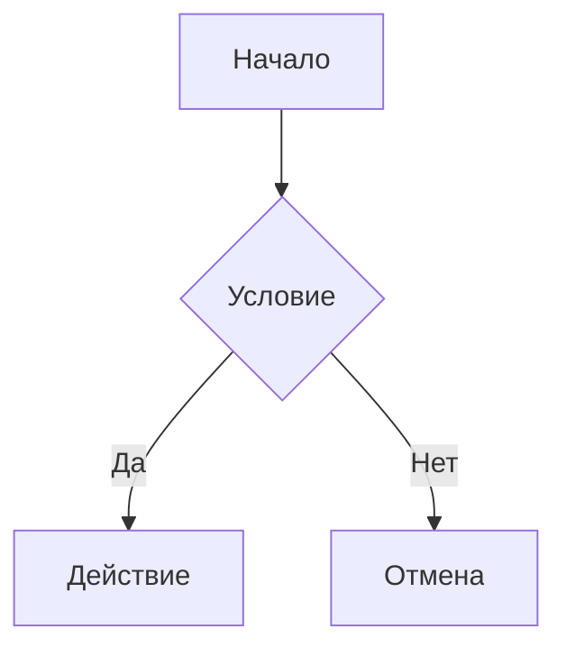
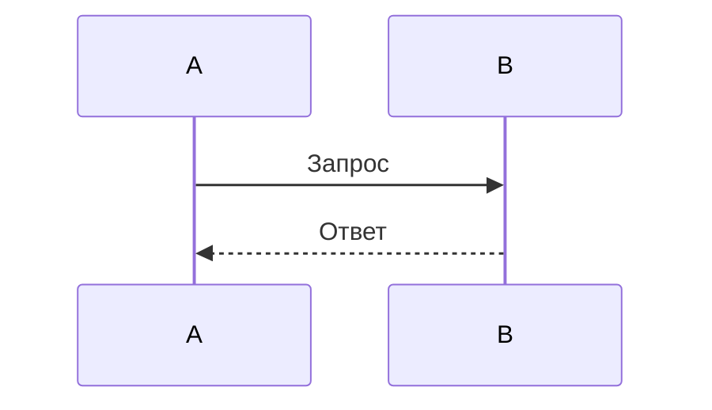

# Ручная проверка MD Viewer перед раздачей

Как пользоваться. Пройдите разделы по порядку. Каждая проверка — это шаги и то, что должно получиться («Ожидается»). Если получилось — поставьте `x` в квадратных скобках: `- [x]`. Если нет — запишите под пунктом, что увидели, и приложите `log.txt` (раздел 2).

Файл можно открыть прямо в MD Viewer: галочки там видны в превью.

Версия (имя zip): ______  Дата: ______  Компьютер / Windows: ______

---

## Условия проверки

Проверяем ровно то, что получит пользователь: **zip-архив** с программой на компьютере, где **MD Viewer ни разу не запускали**.

- **Zip-архив** — тот самый файл, который будет раздаваться (например, `MDViewer-1.0.zip`). Не папка `dist\MDViewer` и не её копия.
- **Где проверять** — можно на своём компьютере, но сначала убрать все следы MD Viewer (см. ниже). Python на компьютере проверке не мешает: собранной программе он не нужен.
- Положите в любую папку **вне проекта** zip, `Проверка.md` (раздел «Тестовый документ» в конце этого файла) и одну любую картинку.

### Очистка перед проверкой

Скрипт `tools\reset-mdviewer.ps1` делает компьютер «как будто MD Viewer тут никогда не было»:
- папку `%APPDATA%\MDViewer` (настройки, сессия, лог, личный словарь) **переименовывает** в `MDViewer_old_<дата>`, а не удаляет. Личный словарь потом можно забрать оттуда: `user-dictionary.txt`;
- из реестра убирает только записи MD Viewer: «Открыть с помощью», пункт контекстного меню, связь с `.md`. Браузер для `.html` и другие программы не трогает.

1. Закройте все окна MD Viewer.
2. Откройте PowerShell в папке проекта и посмотрите, что будет сделано (ничего не меняется):
   ```
   powershell -ExecutionPolicy Bypass -File tools\reset-mdviewer.ps1 -DryRun
   ```
3. Если список устраивает — выполните:
   ```
   powershell -ExecutionPolicy Bypass -File tools\reset-mdviewer.ps1
   ```
4. Ожидается: в конце «Готово, изменено: N». Запустите скрипт ещё раз — должно быть «Следов MD Viewer не найдено».
5. Если скрипт написал «Внимание: Windows не дала удалить выбор…» — откройте Параметры → Приложения → Приложения по умолчанию, найдите `.md` и выберите любую другую программу (например, Блокнот). Иначе пункт 3.1 покажет не то, что увидит новый пользователь.

Перед каждым новым прогоном чек-листа очистку повторяйте.

### Что так проверить нельзя

Это нужно один раз перед раздачей проверить на **другом** компьютере (у знакомого, на старом ноутбуке или в виртуальной машине VirtualBox):
- [ ] Windows 10 (раздел 10);
- [ ] компьютер, где нет WebView2 или он старый (раздел 10);
- [ ] окно SmartScreen при первом запуске скачанного zip (пункт 1.1). На своём компьютере Windows этот файл уже «знает» и может окно не показать.

---

## 1. Запуск

### 1.1. Первый запуск из zip
- [ ] Шаги:
  1. Сделайте очистку (см. «Очистка перед проверкой»).
  2. Правый клик по zip → «Извлечь всё» → в любую папку. **Не** запускайте exe прямо из открытого архива.
  3. Откройте распакованную папку `MDViewer` и дважды щёлкните `MDViewer.exe`.
- Ожидается: появляется экран загрузки, затем окно редактора с приветственным документом. Никаких сообщений об ошибках, ничего не просит установить.
- Если Windows показывает синее окно SmartScreen «Система Windows защитила ваш компьютер»: нажмите «Подробнее» → «Выполнить в любом случае». Это нормально для программы без цифровой подписи. Отметьте, что окно было — это нужно для «Прочитай меня.txt».

### 1.2. Путь с кириллицей и пробелами
- [ ] Шаги:
  1. Распакуйте zip в папку вида `C:\Users\<имя>\Desktop\Моя папка\MD Viewer тест\`.
  2. Запустите `MDViewer.exe`.
  3. Откройте `Проверка.md`, который тоже лежит в папке с русским названием и пробелами.
- Ожидается: программа запускается, файл открывается, картинки и схемы в превью видны.

### 1.3. «О программе»
- [ ] Шаги: кнопка «Справка» (знак вопроса) → «О программе».
- Ожидается: окно с текстом «MD Viewer v1.0». Номер совпадает с тем, что вы раздаёте.

---

## 2. Журнал (log.txt)

- [ ] Шаги:
  1. Запустите `MDViewer.exe` из распакованной папки, поработайте минуту, закройте.
  2. Win+R → `%APPDATA%\MDViewer` → Enter.
- Ожидается: в папке есть `log.txt`. Его можно открыть Блокнотом, текст читается (русские буквы не «кракозябры»). Файл не больше 1 МБ; рядом может лежать одна старая копия.

---

## 3. Связь с файлами в Проводнике

Ассоциации записываются только при запуске **собранного** exe. Перед этими проверками хотя бы раз запустите `MDViewer.exe`.

### 3.1. Двойной клик по .md
- [ ] Шаги: в Проводнике дважды щёлкните по `Проверка.md`.
- Ожидается: открывается MD Viewer, файл открыт во вкладке, название вкладки — `Проверка.md`.
- Если Windows спрашивает «Каким приложением открыть?» — выберите MD Viewer и отметьте это здесь.

### 3.2. Второй файл, когда программа уже открыта
- [ ] Шаги: MD Viewer открыт. Дважды щёлкните другой `.md` в Проводнике.
- Ожидается: файл открывается (новой вкладкой или новым окном), ничего не пропадает из уже открытых вкладок.

### 3.3. Повторное открытие того же файла
- [ ] Шаги: дважды щёлкните `Проверка.md`, который уже открыт.
- Ожидается: второй вкладки с тем же файлом не появляется — программа переключается на уже открытую.

### 3.4. Правый клик по файлу
- [ ] Шаги: правый клик по `.md` → (в Windows 11 — «Показать дополнительные параметры») → «Открыть в MD Viewer».
- Ожидается: пункт есть, рядом иконка программы, файл открывается.

### 3.5. HTML через «Открыть с помощью»
- [ ] Шаги: правый клик по любому `.html` → «Открыть с помощью» → MD Viewer.
- Ожидается: MD Viewer есть в списке. Страница открывается только для чтения (редактировать нельзя), картинки, лежащие рядом с HTML, видны.
- Ожидается также: двойной клик по `.html` по-прежнему открывает браузер — программа не «отбирает» HTML.

### 3.6. Перенос папки программы
- [ ] Шаги:
  1. Закройте MD Viewer.
  2. Перенесите всю папку `MDViewer` в другое место (например, из «Загрузок» в `C:\Программы\`).
  3. Запустите `MDViewer.exe` из нового места один раз, закройте.
  4. Дважды щёлкните по `.md`.
- Ожидается: файл открывается программой из **нового** места, без ошибки «Не удаётся найти...».

---

## 4. Горячие клавиши

Откройте `Проверка.md`, щёлкните в редакторе (левая половина).

### 4.1. Ctrl+U — подчёркивание
- [ ] Шаги: выделите слово, нажмите Ctrl+U.
- Ожидается: слово обернулось в `<u>…</u>`, в превью оно подчёркнуто. **Не** открывается окно с исходным кодом страницы.

### 4.2. Tab и Shift+Tab
- [ ] Шаги: поставьте курсор в пункт списка, нажмите Tab, затем Shift+Tab.
- Ожидается: Tab сдвигает строку вправо (вложенный пункт), Shift+Tab — обратно. Фокус не «убегает» на кнопки панели.

### 4.3. Размер шрифта: Ctrl+плюс, Ctrl+минус, Ctrl+0
- [ ] Шаги:
  1. Нажмите Ctrl+плюс несколько раз (и на основном ряду, и на цифровой клавиатуре).
  2. Нажмите Ctrl+минус несколько раз.
  3. Нажмите Ctrl+0.
- Ожидается:
  - меняется размер текста **только в редакторе**, а не масштаб всего окна (панели и кнопки остаются прежними);
  - больше 30 px и меньше 10 px не становится, сколько ни нажимай;
  - Ctrl+0 возвращает 15 px;
  - в «Настройки» → размер шрифта показывает то же число.
- [ ] Шаги: поставьте, например, 20 px, закройте программу, откройте снова.
- Ожидается: размер 20 px сохранился.

### 4.4. Браузерные клавиши, которые не должны мешать
- [ ] F12 и Ctrl+Shift+I — ничего не происходит (панель разработчика не открывается).
- [ ] Ctrl+колесо мыши — масштаб окна не меняется.
- [ ] F5 и Ctrl+R — страница перезагружается, текст при этом не теряется (подробно в 6.2).

### 4.5. Остальные сочетания (быстрый прогон)
- [ ] Ctrl+B, Ctrl+I, Ctrl+Shift+X, Ctrl+` — жирный, курсив, зачёркнутый, код.
- [ ] Ctrl+N — новый документ, Ctrl+T — новая вкладка, Ctrl+O — окно открытия файла.
- [ ] Ctrl+S, Ctrl+Shift+S — сохранить / сохранить как.
- [ ] Ctrl+Tab, Ctrl+Shift+Tab — переход между вкладками.
- [ ] Ctrl+F — поиск; Enter / Shift+Enter — следующее / предыдущее; Esc — закрыть.
- [ ] Ctrl+Z / Ctrl+Y — отмена и повтор.
- [ ] Ctrl+Q — выход.
- Ожидается: всё делает то, что написано в «Справка» → «Горячие клавиши».

---

## 5. Перетаскивание и иконка

### 5.1. Файл из Проводника в окно
- [ ] Шаги: перетащите `.md` из Проводника мышью в окно MD Viewer и отпустите.
- Ожидается: файл открывается во вкладке. Текст файла **не** вставляется внутрь текущего документа.
- [ ] То же с `.html`. Ожидается: открывается только для чтения.

### 5.2. Иконка
- [ ] Ожидается: иконка программы видна в заголовке окна, на панели задач, в Alt+Tab и у `MDViewer.exe` в Проводнике. Нигде нет стандартной иконки Python или пустого листа.

---

## 6. Текст не теряется

### 6.1. Закрытие вкладки с изменениями
- [ ] Шаги: в сохранённом файле допишите слово (на вкладке появится точка «Есть несохранённые изменения»), нажмите Ctrl+W.
- Ожидается: окно «Сохранить изменения?» с кнопками. Проверьте все три варианта:
  - «Сохранить» — файл записан, вкладка закрыта;
  - «Не сохранять» — вкладка закрыта, файл на диске прежний;
  - крестик / отмена — вкладка осталась, текст на месте.

### 6.2. F5 с несохранённым текстом
- [ ] Шаги: напишите текст в новом (ни разу не сохранённом) документе, нажмите F5.
- Ожидается: после перезагрузки текст на месте, курсор там же или рядом.

### 6.3. Процесс убит через Диспетчер задач
- [ ] Шаги:
  1. Напишите текст в новом документе и допишите строку в открытый файл. **Не сохраняйте.**
  2. Подождите 3–5 секунд.
  3. Ctrl+Shift+Esc → найдите MD Viewer → «Снять задачу».
  4. Запустите программу снова.
- Ожидается: обе вкладки на месте, несохранённый текст в них есть, точка «несохранённые изменения» стоит.

### 6.4. Закрытие окна крестиком с несохранённым текстом
- [ ] Шаги: напишите текст, не сохраняя, закройте окно крестиком. Запустите программу снова.
- Ожидается: окно закрывается без вопросов; при следующем запуске текст восстановлен.

---

## 7. Несколько окон

### 7.1. Вкладка в новое окно
- [ ] Шаги: откройте 3 вкладки. Возьмите одну мышью и вытащите за пределы окна, отпустите.
- Ожидается: во время перетаскивания рядом с курсором виден «призрак» вкладки; после отпускания появляется новое окно с этой вкладкой. В старом окне её больше нет.

### 7.2. Вкладка обратно
- [ ] Шаги: перетащите вкладку из нового окна на полосу вкладок первого окна.
- Ожидается: вкладка переехала; окно, в котором не осталось вкладок, закрылось само.

### 7.3. Перестановка вкладок
- [ ] Шаги: перетащите вкладку влево-вправо внутри полосы.
- Ожидается: порядок меняется, крестики на вкладках ровные.

### 7.4. Восстановление сессии из нескольких окон
- [ ] Шаги:
  1. Сделайте 2 окна, в каждом по 2 вкладки, в одной — несохранённый текст.
  2. Нажмите Ctrl+Q.
  3. Запустите программу.
- Ожидается: открываются оба окна с теми же вкладками, несохранённый текст на месте.
- [ ] Повторите, но вместо Ctrl+Q снимите задачу в Диспетчере задач. Ожидается то же самое.

---

## 8. Внешний вид

### 8.1. Масштаб Windows 125% и 150%
- [ ] Шаги: Параметры → Система → Дисплей → Масштаб → 125%. Запустите программу, откройте `Проверка.md`. Повторите для 150%. Верните свой масштаб.
- Ожидается: текст чёткий (не размытый), кнопки не наезжают друг на друга, всё помещается в окно, экран загрузки по центру и не обрезан.

### 8.2. Тёмная и светлая темы
- [ ] Шаги: нажмите кнопку «Сменить тему» несколько раз.
- Ожидается: меняются редактор, превью, схемы Mermaid и графики, заголовок окна Windows тоже в цвет темы. Весь текст читается (нет тёмного на тёмном).
- [ ] Шаги: оставьте светлую тему, закройте, откройте программу.
- Ожидается: открывается в светлой теме, без «мигания» тёмной при загрузке. Новое окно (из 7.1) тоже сразу в нужной теме.

---

## 9. Экспорт HTML и печать

### 9.1. Экспорт без интернета
- [ ] Шаги:
  1. Откройте `Проверка.md`, дождитесь, пока нарисуются все схемы и графики.
  2. Отключите интернет (Wi-Fi выключить или кабель вынуть).
  3. «Файл» → «Экспортировать HTML как...» → выберите тему → сохраните.
  4. Откройте полученный HTML в браузере (Edge или Chrome).
- Ожидается:
  - всё, что было в превью, есть и в HTML: заголовки, таблица, подсветка кода, схема Mermaid, UML (nomnoml), график;
  - на графике при наведении мыши всплывает подсказка с числом, легенда кликается;
  - тема та, что вы выбрали;
  - в конце экспорта была анимация, программа не зависла.

### 9.2. Картинки в экспорте
- [ ] Шаги: «Настройки» → Изображения в экспорте → «Встраивать». Экспортируйте документ с локальной картинкой в другую папку (не туда, где лежит картинка). Откройте HTML.
- Ожидается: картинка видна.
- [ ] С вариантом «Не встраивать» и HTML в другой папке. Ожидается: картинки нет (подсказка в настройках об этом предупреждает) — это нормально.

### 9.3. Печать
- [ ] Шаги: Ctrl+P.
- Ожидается: открывается окно печати. В предпросмотре печати посмотрите, как выглядит документ, и запишите сюда, что именно печатается (весь интерфейс или только превью), — от этого зависит, делать ли отдельную печать позже.

---

## 10. Windows 10

- [ ] Шаги: на компьютере с Windows 10 откройте «Параметры» → «Приложения» и найдите «Microsoft Edge WebView2 Runtime».
- Ожидается: он установлен (обычно ставится вместе с Edge). Программа запускается и работает как в разделе 1.
- Если его нет: запишите, что показала программа при запуске. Это нужно для «Прочитай меня.txt».

---

## 11. После обновления pywebview или pythonnet

Программа использует внутренние места этих библиотек, поэтому после любого обновления `requirements.txt` соберите новый zip, сделайте очистку и обязательно пройдите:
- [ ] 4.1 — Ctrl+U
- [ ] 4.2 — Tab и Shift+Tab
- [ ] 4.3 — Ctrl+плюс и Ctrl+минус
- [ ] 5.1 — перетаскивание файлов из Проводника
- [ ] 5.2 — иконка окна
- [ ] 7.1 — вкладка в новое окно
- [ ] `python -m pytest` в venv проекта — все тесты зелёные

---

## Тестовый документ

Скопируйте всё, что между линиями, в файл `Проверка.md`. Путь к картинке в строке `` замените на настоящую картинку на вашем компьютере (слэши — обычные `/`).

---

````markdown
# Проверка MD Viewer

Обычный текст, **жирный**, *курсив*, ~~зачёркнутый~~, <u>подчёркнутый</u>, `код`.
Ошибка в слове для проверки орфографии: превед.

## Список

- первый пункт
  - вложенный пункт
- [ ] задача
- [x] сделанная задача

1. раз
2. два

> Цитата

## Таблица

| Имя   | Число |
|:------|------:|
| Альфа | 1     |
| Бета  | 2     |

## Код

```python
def hello(name):
    return f"Привет, {name}!"
```

## Картинка

{width=400px}

## Схема



## UML



```nomnoml
[Пользователь] -> [Вход]
[Пользователь] -> [Просмотр]
```

## График

```chart
type: bar
| Месяц | Продажи |
|-------|---------|
| Янв   | 30      |
| Фев   | 50      |
| Мар   | 70      |
```

:::center
Текст по центру
:::

[Ссылка в браузере](https://example.com)
````
